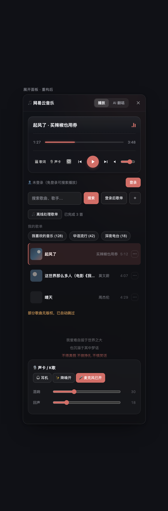
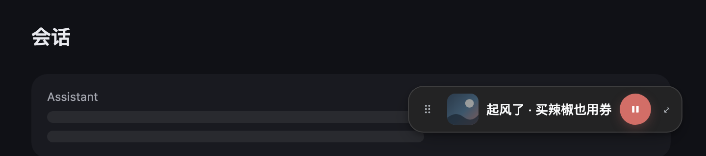
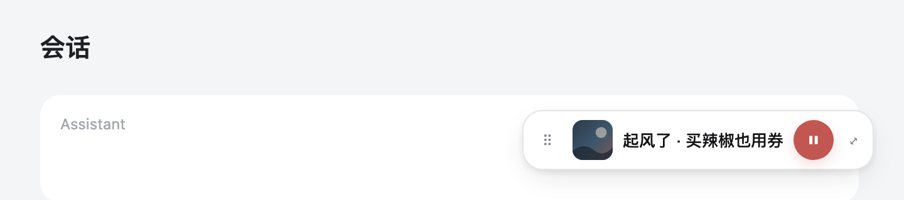

# dsh-music · 网易云音乐播放器（DeepSeek Harness 插件）

常驻在 DeepSeek Harness 页面右下角的网易云音乐播放器：扫码登录、搜索（歌曲 + 歌单）、我的歌单、在线播放、进度条跳转，可拖动；收起是 48px 迷你浮条，点开展开完整面板。



## 功能

- 🎵 **右下角迷你浮条**：封面 / 歌名·歌手 / 播放暂停 / 展开；`⠿` 拖动，位置不写死
- 🎧 **展开面板**：当前播放卡（上一首 / 播放暂停 / 下一首 / 可点可拖进度条 / 音量）、搜索、我的歌单、歌曲列表
- 🔒 **扫码登录**：网易云 App 扫码，登录态存浏览器 `localStorage`（键 `dsh-ncm-cookie`），刷新自动恢复
- 🔍 搜索同时返回**歌曲**与**相关歌单**；支持按歌手展开、歌单批量离线处理
- 📜 歌词滚动、🎙 声卡 / K 歌（可选，需 Python + Demucs 生成伴奏）

## 视觉设计

本次重构按 8px 栅格统一间距与尺寸，建立标题 / 次要文字两级字号，配色改为低饱和珊瑚红，深/浅色主题跟随 DSH（`--dsw-alias-*`）：

| 项 | 规格 |
|---|---|
| 迷你浮条 | 高 48、内边距 8、间距 8、圆角 16；封面 32 / 圆角 8；播放键 32 圆 |
| 展开面板 | 宽 408、圆角 16；头部 56；内容区 16 内边距 |
| 字体层级 | 标题 14/20/600、正文 13/20/500、次要 12/16/400、时间 12 tabular |
| 色彩 | 深色 `#14151A` 面板 + `#D26E67` 珊瑚；浅色 `#FFFFFF` + `#C25650` |
| 圆角 | 卡片 16 / 封面与按钮 8 / 播放键与轨道 999 |
| 阴影 | 静置 `0 8px 24px -8px`、悬停 `0 12px 32px -8px`、面板 `0 24px 64px -24px` |
| 热区 | 小控件 32×32（横向热区 40）、播放键 40×40、进度条热区 448×16 |

<p>
  
  
</p>

## 架构

插件由两部分组成，通过 DSH profile 的 `cordis.patch.yml` 补丁层接入：

| 部分 | 安装位置 | 作用 |
|---|---|---|
| `host/` | `~/.dsh/plugins/dsh-music/` | 宿主插件：DSH 启动时拉起网易云 API 服务（默认端口 3000） |
| `host/netease-api/` | 同上 | 基于 [`NeteaseCloudMusicApi`](https://github.com/Binaryify/NeteaseCloudMusicApi) 的启动器，附带 `/karaoke` 伴奏生成 |
| `client/` | `~/.dsh/profiles/node_modules/@deepseek-ai/dsh-client-ui-music/` | 浏览器端播放器 UI（注册在 `shell.overlay` 插槽） |

客户端 `fetch` 直连 `http://127.0.0.1:3000`（服务自带 CORS），无需代理。

## 安装

> 前置：Node.js ≥ 18、已安装并可运行 `dsh web`。

### macOS / Linux 一键安装

```bash
git clone https://github.com/superkonka/dsh-music.git
cd dsh-music
bash install.sh
```

### Windows 一键安装

```powershell
git clone https://github.com/superkonka/dsh-music.git
cd dsh-music
.\install.ps1
```

脚本会：拷贝宿主插件与客户端 bundle → `npm install` 网易云 API → 把两行 patch 追加到 `~/.dsh/profiles/web/cordis.patch.yml`（已存在则跳过）。

> 若本机 npm 配了失效代理（`.npmrc` 的 `proxy`），`npm install` 会失败；先修正或改用镜像源。

### 手动安装

1. **宿主插件 + API 服务**

   ```bash
   DSH=~/.dsh
   mkdir -p "$DSH/plugins/dsh-music/netease-api"
   cp host/index.js "$DSH/plugins/dsh-music/index.js"
   cp host/netease-api/launch.js host/netease-api/package.json host/netease-api/separate.py \
      "$DSH/plugins/dsh-music/netease-api/"
   (cd "$DSH/plugins/dsh-music/netease-api" && npm install --no-audit --no-fund)
   ```

2. **客户端 UI**

   ```bash
   C=~/.dsh/profiles/node_modules/@deepseek-ai/dsh-client-ui-music
   mkdir -p "$C/lib"
   cp client/package.json "$C/package.json"
   cp client/lib/index.js client/lib/client.js "$C/lib/"
   ```

3. **接入补丁** —— 追加到 `~/.dsh/profiles/web/cordis.patch.yml`（路径换成你的实际路径）：

   ```yaml
   - insert:
       - id: ui-music
         name: '@deepseek-ai/dsh-client-ui-music'
   - insert:
       - id: tool-music-server
         name: 'file:///Users/<你>/.dsh/plugins/dsh-music/index.js'
         config:
           nodePath: '/opt/homebrew/bin/node'
           serverScript: '/Users/<你>/.dsh/plugins/dsh-music/netease-api/launch.js'
           port: 3000
   ```

4. 重启 DSH（或整页刷新），右下角出现 🎵 浮条。

## 使用

1. 点右下角浮条展开面板；
2. 首次点「登录」，用网易云音乐 App 扫码；
3. 搜索歌曲 / 点「我的歌单」加载歌单，点歌曲播放；
4. 收起后浮条可直接 ▶/⏸，按住 `⠿` 拖动位置。

## 可选：伴奏生成（K 歌 / 声卡）

`/karaoke` 接口会调 `separate.py` 用 Demucs 分离人声生成伴奏，需自行安装：

```bash
python3 -m pip install demucs
# 另需 ffmpeg
```

并用环境变量指定解释器（默认 Windows 为 `python`、其他平台为 `python3`）：

```bash
export DSH_PYTHON=/opt/homebrew/bin/python3
```

分离结果缓存在 `host/netease-api/karaoke-cache/`（已在 `.gitignore` 中忽略）。

## 注意事项

- 登录 cookie 只存在浏览器 `localStorage`，**不落服务端**；「退出」会清除。
- VIP / 无版权歌曲会返回「暂时无法播放」。
- 网易云接口属非官方接口，稳定性与账号风控风险自负，请勿高频请求。
- 通过 `cordis.patch.yml` 接入 profile；重装 profile 后需重新执行安装。
- AI 翻唱入口为独立的本地插件（`@local/dsh-cover-v4`），不在本仓库内；缺省时播放器会隐藏该标签页。

## 目录结构

```
dsh-music/
├── host/
│   ├── index.js                 # 宿主插件：启动/托管 API 服务
│   └── netease-api/
│       ├── launch.js            # NeteaseCloudMusicApi 启动器 + /karaoke
│       ├── separate.py          # Demucs 人声分离
│       └── package.json
├── client/
│   ├── package.json             # @deepseek-ai/dsh-client-ui-music 清单
│   └── lib/
│       ├── index.js             # 宿主空入口
│       └── client.js            # 浏览器端播放器 bundle（手写 bundle，无构建依赖）
├── assets/                      # 截图
├── install.sh                   # macOS / Linux 一键安装
├── install.ps1                  # Windows 一键安装
└── README.md
```

## 开发

客户端 `client/lib/client.js` 是手写 bundle（`window.__ModuleLoader__.load({...})`），无构建步骤：改完文件后**整页刷新**页面即可（样式在模块加载时注入，有「只注入一次」保护，热更新不会重写 style）。

## License

MIT
